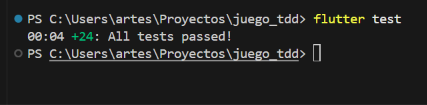
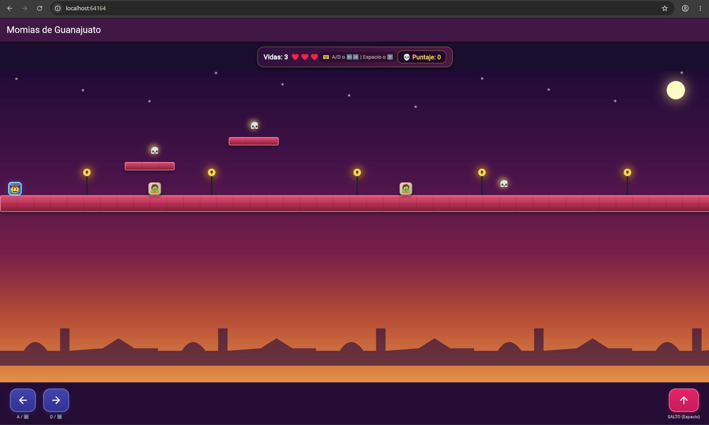
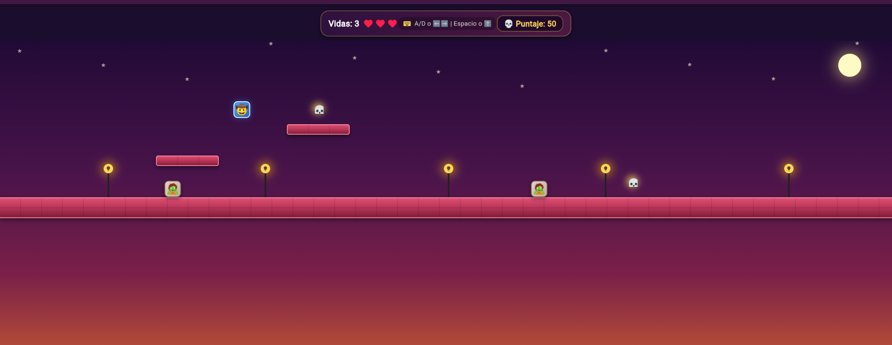
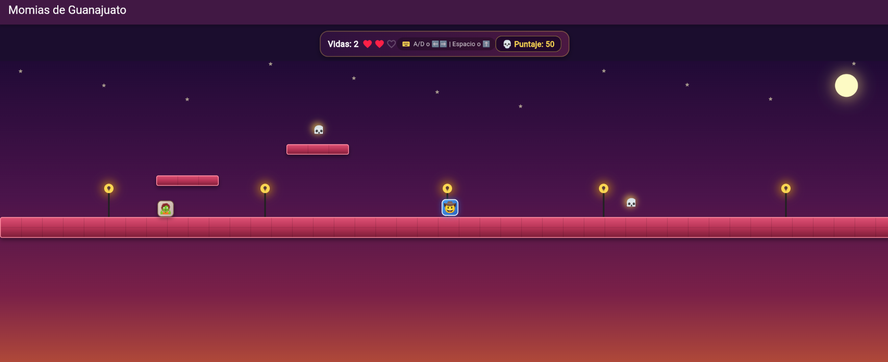
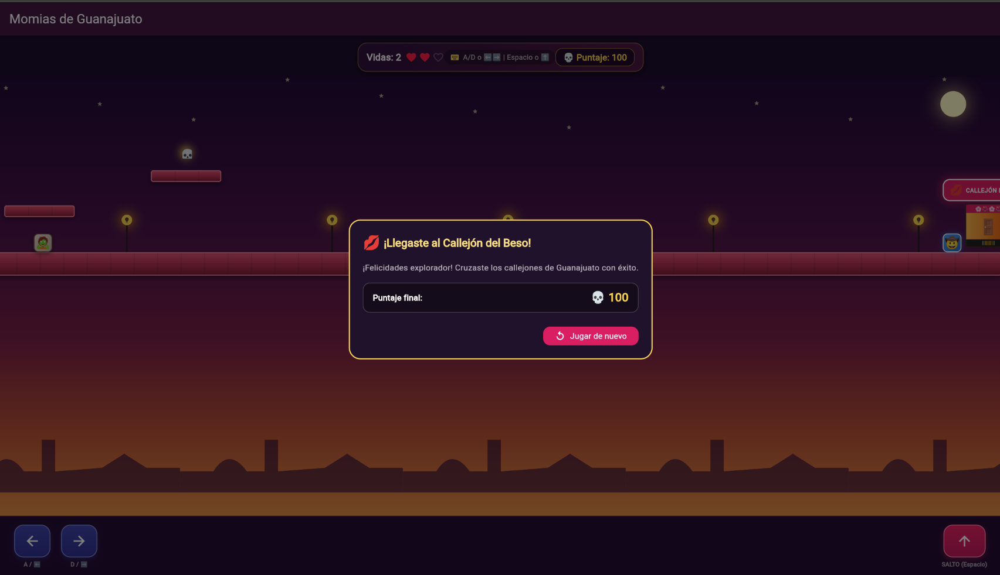
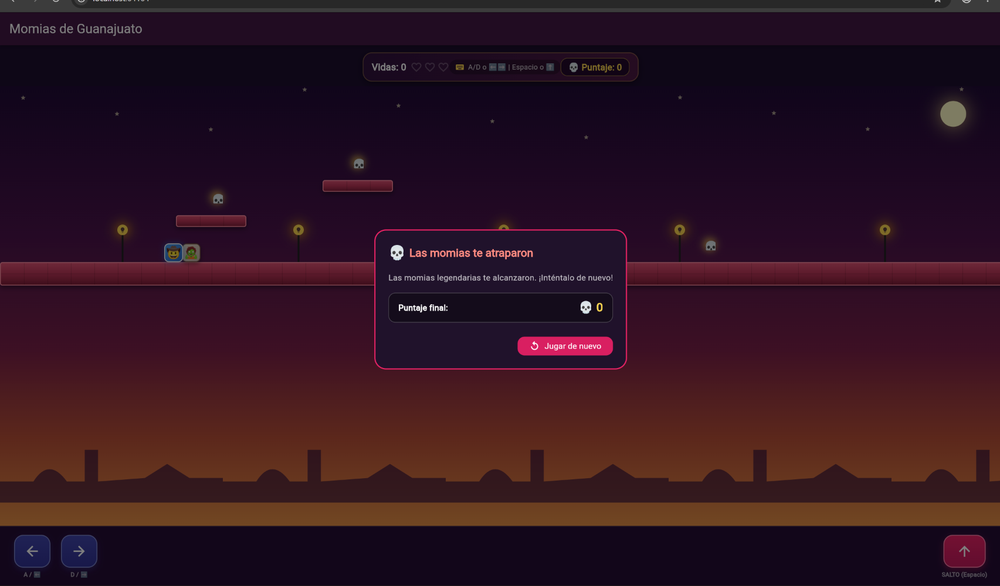

# 🤠 Momias de Guanajuato: La Leyenda 🧟💀

> **Desarrollo Móvil Integral — Proyecto de Práctica TDD**  
> Un videojuego de plataformas en 2D con física real, gravedad, colisiones AABB, inteligencia artificial de patrullaje y combate tipo *stomp*, **construido 100% mediante Test-Driven Development (TDD) en Flutter/Dart**.

---

## 📖 Descripción del Proyecto

En este juego, un intrépido explorador debe recorrer los legendarios callejones de Guanajuato saltando entre plataformas de cantera rosa, esquivando momias que patrullan incansablemente, recolectando calaveritas de azúcar para sumar puntos y avanzando hasta alcanzar el mítico **Callejón del Beso** 💋.

### 🎮 Mecánicas de Juego
- **Física Real:** Caída por gravedad, impulso de salto con rebote e impacto sobre plataformas mediante detección de posición previa (*costura testable*).
- **Controles Híbridos (Teclado y Táctil):**
  - **Teclado:** `A` / `D` o Flechas `⬅️` / `➡️` para desplazarse; `W`, Flecha `⬆️` o `Barra Espaciadora` para saltar.
  - **Táctil:** Botones ergonómicos con respuesta táctil en pantalla.
- **Ambientación Visual Colonial:** Fondo con degradado crepuscular de Guanajuato, luna y estrellas, silueta colonial de cúpulas con parallax, plataformas de cantera rosa esculpida con textura de sillares, faroles coloniales y el emblemático balcón del Callejón del Beso con bugambilias.
- **Inteligencia Artificial de Patrullaje:** Las momias caminan entre límites fijos e invierten su dirección automáticamente.
- **Sistema de Combate ("Stomp"):** Saltar sobre la mitad superior de una momia la aplasta y hace rebotar al jugador. Un impacto lateral resta una vida y reinicia la posición.
- **Objetos Coleccionables:** Calaveritas de azúcar (+50 puntos cada una) con resplandor dorado.
- **Cámara Dinámica Horizontal:** El mundo se desplaza suavemente siguiendo la posición del explorador.
- **Condiciones de Victoria y Derrota:** Llegar a la meta (1900 px) otorga la victoria; perder las 3 vidas termina la partida (*Game Over*).

---

## 🏛️ Arquitectura Limpia y TDD Puro

Toda la lógica del juego reside en `lib/logica/` como código **Dart puro**, completamente desacoplado del framework de UI de Flutter. Esto garantiza que el motor físico y las reglas del juego sean deterministas, ultra-rápidos de ejecutar y 100% testeables antes de crear cualquier widget visual.

```text
lib/
├── logica/
│   ├── rectangulo.dart         # Detección de colisiones AABB
│   ├── personaje.dart          # Estado y dimensiones del explorador
│   ├── momia.dart              # Patrullaje determinista de enemigos
│   ├── calaverita.dart         # Coleccionables y puntaje
│   ├── motor_fisica.dart       # Gravedad, salto, piso y límites
│   ├── motor_combate.dart      # Mecánica stomp vs daño lateral
│   ├── estado_juego.dart       # Enum de estados (jugando, ganado, perdido)
│   └── motor_juego.dart        # Orquestador del bucle principal
├── presentation/
│   └── juego_screen.dart       # Cámara lateral, HUD, controles y renderizado
└── main.dart                   # Punto de entrada de la app
```

---

## ✅ Checklist de Verificación TDD

A continuación se muestra el checklist de verificación del proyecto, cumplido al 100%:

| Criterio | Estado | Descripción Técnica |
| :--- | :---: | :--- |
| **Colisión AABB aislada** | ☑ Cumplido | `Rectangulo` (`intersectaCon`) se probó de forma unitaria y aislada antes de integrarse al resto del juego. |
| **Detección con posición anterior** | ☑ Cumplido | `resolverColisionConPiso` emplea `yAnterior` (parámetro-costura) para discriminar caídas legítimas de atravesamientos indeseados. |
| **Criterio de 'Stomp' riguroso** | ☑ Cumplido | Requiere caer (`velocidadY > 0`) Y que el pie del jugador esté ubicado en la mitad superior de la momia. Evita victorias por colisión lateral accidental. |
| **Determinismo en tiempo/patrullaje** | ☑ Cumplido | `patrullar()` y las físicas son puras y no dependen de temporizadores del sistema en las pruebas. |
| **Orquestación única en MotorJuego** | ☑ Cumplido | `MotorJuego.mover()` define estrictamente el orden de resolución: límites horizontales ➔ gravedad ➔ colisión con piso ➔ momias/combate ➔ calaveritas ➔ meta. |
| **Separación estricta UI / Lógica** | ☑ Cumplido | La pantalla (`JuegoScreen`) no calcula físicas ni colisiones; traduce fielmente el estado de `MotorJuego` a coordenadas visuales y widgets. |

---

## 🧪 Pruebas Unitarias e Integración (`flutter test`)

Se implementaron pruebas exhaustivas distribuidas en las 10 rondas del desarrollo guiado por pruebas:

1. **`test/rectangulo_test.dart`**: Verificación de traslape e intersección AABB.
2. **`test/motor_fisica_test.dart`**: Pruebas de gravedad, salto en suelo/aire, aterrizaje con memoria previa, límites laterales y meta.
3. **`test/momia_test.dart`**: Pruebas de avance en línea recta, inversión de dirección en límites y estado derrotado.
4. **`test/motor_combate_test.dart`**: Caída superior (stomp), choque lateral (daño) y ausencia de colisión.
5. **`test/motor_juego_test.dart`**: Recolección de calaveritas, consumo de vidas al ser golpeado, Game Over y prueba de integración para ganar llegando a la meta.
6. **`test/widget_test.dart`**: Prueba de humo del ciclo de vida visual de la aplicación.

Para ejecutar la suite completa de pruebas:
```bash
flutter test
```

---

## 📸 Evidencias de Ejecución y Pruebas

Las imágenes se ubican dentro de la carpeta [`evidencias/`](./evidencias/).

### 1. Pruebas Unitarias e Integración en Verde (`flutter test`)
Muestra la consola ejecutando `flutter test` con todos los tests pasando exitosamente.



---

### 2. Inicio del Juego y Controles de Movimiento
Explorador al inicio del nivel con sus 3 vidas, puntaje en 0, plataformas rosas de Guanajuato y botones táctiles en pantalla.



---

### 3. Patrullaje de Momias y Recolección de Calaveritas
El explorador saltando entre plataformas, recolectando calaveritas (+50 pts cada una) y esquivando momias.



---

### 4. Combate: Aplastando una Momia ("Stomp")
Demostración del salto encima de una momia derrotándola y rebotando.



---

### 5. Victoria: ¡Llegaste al Callejón del Beso! 💋
Llegada a la meta final en los 1900 px, activando el diálogo animado de felicitaciones y puntaje obtenido.



---

### 6. Fin de Juego (Game Over)
Pérdida de las 3 vidas al colisionar de frente con las momias, mostrando el diálogo de fin de partida.



---

## 🚀 Cómo Ejecutar el Juego

1. Clona el repositorio o abre la carpeta en tu entorno local.
2. Obtén las dependencias:
   ```bash
   flutter pub get
   ```
3. Ejecuta los tests:
   ```bash
   flutter test
   ```
4. Inicia el juego en tu navegador web o dispositivo:
   ```bash
   flutter run -d chrome
   ```
   *(o `flutter run` en un emulador Android / dispositivo físico)*.
